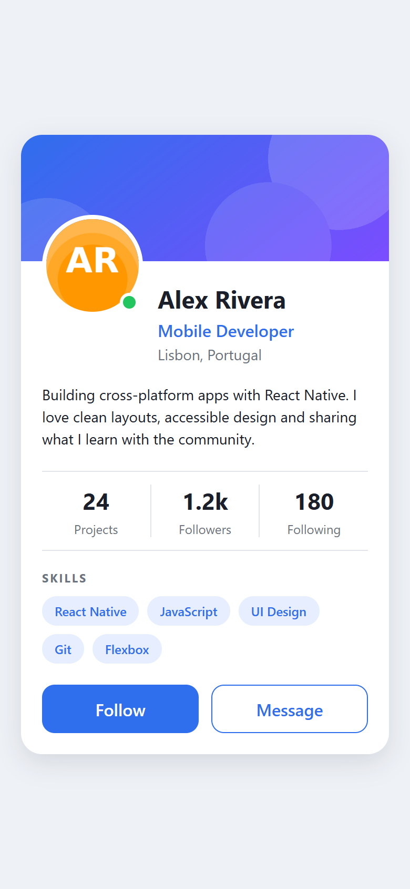

# Profile Card — React Native

Expo implementation of the supplied practical task. Original requirements are in [ASSIGNMENT.md](ASSIGNMENT.md), and the six checkpoint responses are in [ANSWERS.md](ANSWERS.md).

## Run

Install Node.js LTS, then run:

```sh
npm ci
npm start
```

Scan the QR code with an Expo Go version compatible with this project's Expo SDK, or open an Android/iOS emulator. For the browser preview, run `npm run web`.

## Implementation

- Core View, Text and Image components with named StyleSheet styles.
- Local banner and avatar, overlapping avatar and absolute online indicator.
- Equal-width statistics and action layouts; wrapping skill tags.
- Centralized colors, platform-specific shadows and rounded corners.
- Bonus: reusable StatItem and Tag components, Skills heading and a 420-point maximum card width when the screen is wider than 600 points.
- Follow and Message are visual-only, as requested by the assignment.

## Submission

Preview captured from the running web version (390 × 844 viewport):



Validation: Android, iOS and web exports completed; ESLint and TypeScript checks passed; Expo Doctor passed 20/20 checks. The web preview ran without JavaScript errors. A physical-device or native-emulator run remains to be checked. npm reported 8 dependency advisories (5 low, 3 high) in the generated dependency tree; no forced major upgrades were applied.

```sh
npm run lint
npm run typecheck
```

Work is on `task/profile-card`, with commits for the five steps. Push `main` and `task/profile-card` to your GitHub repository, then open a Pull Request from `task/profile-card` to `main` and attach a screenshot of the running app. `expected-result.png` is the assignment reference, not proof of a run.

```sh
git remote add origin https://github.com/YOUR_USERNAME/profile-card.git
git push -u origin main
git push -u origin task/profile-card
```
