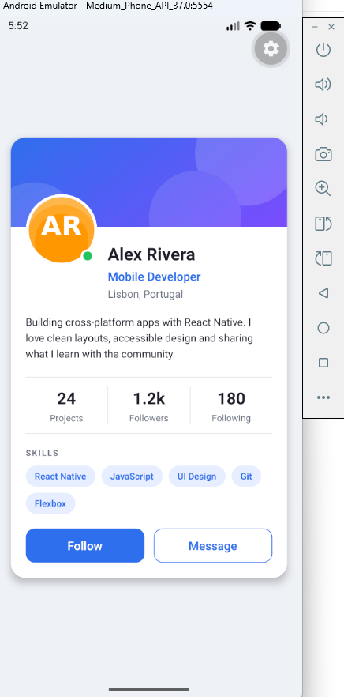

# Profile Card — Sprint 1

React Native profile card built with Expo, using View, Text, Image, Flexbox and StyleSheet.

## Run

Install Node.js LTS, open a terminal in this folder and run:

```sh
npm ci
npm start
```

On Windows PowerShell, use `npm.cmd ci` and `npm.cmd start` if script execution is blocked.

With an Android emulator running, press `a` in the Expo terminal. You can also scan the QR code with a compatible Expo Go app on your phone. For a browser preview, run `npm run web`.

## Task

The card includes a banner, circular avatar, online badge, biography, statistics, skill tags and two visual action buttons. Follow and Message have no interaction, as requested.

Bonus features: reusable StatItem and Tag components, a Skills heading and a maximum card width of 420 on screens wider than 600.

The six checkpoint answers are in [ANSWERS.md](ANSWERS.md).

## Android emulator


